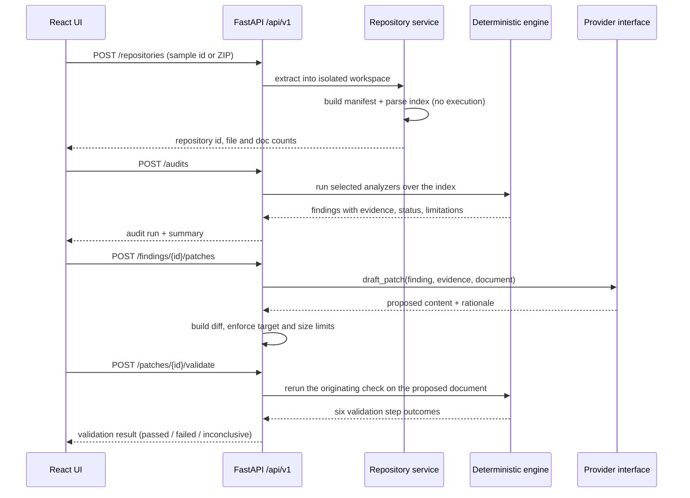

# Architecture

## Request path

## Layers

| Layer | Location | Responsibility |
|---|---|---|
| HTTP | `backend/app/api/` | Routing, session cookie, request IDs, error envelopes. No business logic. |
| Schemas | `backend/app/schemas/models.py` | The public contract. Mirrored by `frontend/src/lib/types.ts`. |
| Core | `backend/app/core/` | Typed settings, error taxonomy, ZIP and path safety, redaction. |
| Analyzers | `backend/app/analyzers/` | Pure functions over a parsed index. No I/O beyond reading files. |
| Services | `backend/app/services/` | Intake, indexing, audit orchestration, Q&A retrieval, patch lifecycle, export. |
| Integrations | `backend/app/integrations/` | Provider protocol, local demo provider, Alan adapter. |
| UI | `frontend/src/` | Screens per feature, one HTTP module, per-operation async state. |

## Architectural rules

| ID | Rule | Where it is enforced |
|---|---|---|
| AR-01 | The model never invents repository facts | Evidence bundles are built by `evidence_service` / analyzers before any provider call |
| AR-02 | Every model output is schema-checked and re-verified | `question_service._verify_citations`, `patch_service.validate` |
| AR-03 | Analyzers never depend on the provider layer | Analyzer modules import nothing from `integrations/` |
| AR-04 | The extracted repository is read-only | Patches are written to `patch/`, never to `repo/` |
| AR-05 | Analyzers are independently runnable and testable | `analyze(index) -> AnalyzerResult`, one test file per concern |
| AR-06 | One process, no queue, no worker tier | Everything runs inside the FastAPI app |

## Index and data flow

`build_index(root)` walks non-excluded files once and produces a `RepoIndex`:

- `docs`: parsed Markdown with headings, links, code spans, tables, and documented routes.
- `py_files`: `ast`-parsed modules with symbols, decorator routes (prefix-resolved), and environment references.
- `env_example_keys`: the canonical variable list from `.env.example`.
- `skipped`: files that could not be read or parsed, surfaced as limitations.

Nothing executes repository code. A file that fails to parse becomes a skip with a reason, never a failed audit.

Validation reuses the same machinery with a document override: `RepoIndex.with_doc_override(path, text)` returns
a new index whose doc-derived structures are rebuilt from the proposed content, so step V-3 can ask the
originating analyzer whether the finding still reproduces.

## State and lifecycle

| Concern | Implementation |
|---|---|
| Session | Anonymous `HttpOnly` cookie minted on first response; workspaces are scoped to it |
| Workspace | `WORKSPACE_ROOT/{repo_id}/repo` (immutable) and `/patch` (drafts, exports) |
| Cleanup | Deleted on `DELETE /repositories/{id}`, on TTL expiry, and by a sweep on access |
| Audit history | In memory per session; a backend restart clears it (no database in v1.0) |
| Finding identity | `sha256(check_id, primary_path, subject_key)[:12]`, excluding line numbers |

## Extension points

- **New check:** implement an analyzer, register it, update `SPEC.md` §8 and §29.
- **New language:** add a parser next to `parse_python` that populates the same symbol/route structures.
- **New provider:** implement the `ModelProvider` protocol and extend the factory in
  `integrations/model_provider.py`.